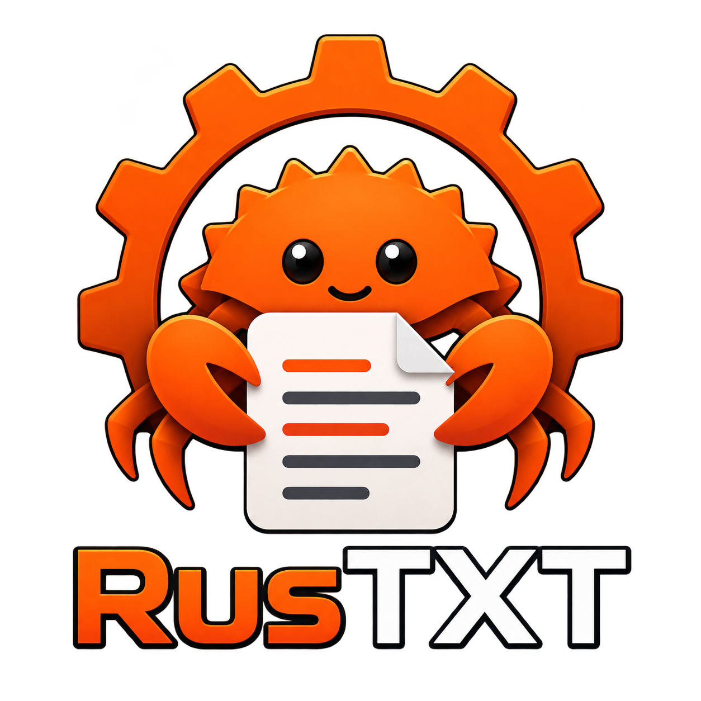
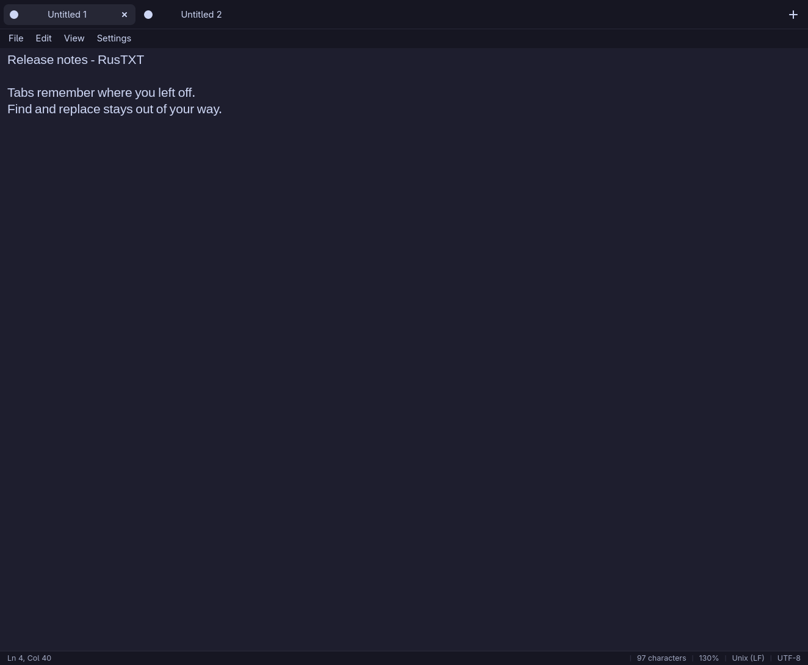

<p align="center"></p>

# RusTXT

A small, recoverable plain text editor built with Rust and Iced for Linux,
Windows, and macOS.

Linux, Windows, and macOS use the same Iced interface and recovery engine. The
released app has no GTK dependency.

## Download and install

Get the packages from [the latest release](https://github.com/tsubaie/RusTXT/releases/latest).

| Platform | Download and installation |
|---|---|
| Linux x86_64 | Extract the Linux `.tar.gz` and run `./install.sh`; requires glibc 2.35+ (Ubuntu 22.04+). |
| Arch / Omarchy | `sudo pacman -U rustxt-*.pkg.tar.zst` |
| Debian 13+ | `sudo apt install ./rustxt_*_amd64.deb` |
| Fedora 42+ | `sudo dnf install ./rustxt-*.x86_64.rpm` |
| Windows x86_64 | Extract the Windows ZIP and run `rustxt.exe`. No installer or Visual C++ redistributable required. |
| macOS Apple Silicon | Extract `arm64-macos.zip` and move RusTXT.app to Applications. |
| macOS Intel | Extract `x86_64-macos.zip` and move RusTXT.app to Applications. |

Verify downloads with the release's `SHA256SUMS`. macOS bundles are ad-hoc signed,
not Apple-notarized; macOS may require **System Settings → Privacy & Security →
Open Anyway**. Windows executables are unsigned. Linux file dialogs need an XDG
desktop portal and a portal backend for your desktop. The tarball also needs the
libxkbcommon and libxkbcommon-x11, libwayland-client, libX11 and libX11-xcb,
libXcursor, libXi, and fontconfig runtime libraries; the native Arch, Debian, and
Fedora packages declare those dependencies so the package manager installs them.
See [SECURITY.md](SECURITY.md) for what the app stores on disk.



## Features

- Tabs, keyboard shortcuts, file drag and drop, and single-instance file forwarding.
- SQLite recovery snapshots every 250 ms while editing, including unsaved notes.
- Undo/redo history and cursor/scroll positions restored across restarts.
- Close a tab and reopen it with Ctrl+Shift+T. Permanent discard requires
  confirmation and also deletes the note's undo history.
- Find and replace with match counting, case sensitivity, whole words, and regex captures.
- Atomic file saves, external-change protection, symlink handling, and CRLF
  preservation. Lone CR line endings are normalised to LF on load. Files over
  64 MiB and non-regular files are refused with an error instead of being loaded.
- Arabic/English editing, Unicode font fallback, word wrap, zoom, and a status bar.
- System, light, dark, Omarchy, and custom themes; live configuration reloads.
- Native file dialogs. Printing opens a local print view in the default browser.

The interface uses in-window menus. On macOS, command shortcuts use Cmd; tab
cycling uses Ctrl+Tab. The About dialog links to the latest release page; the
app never downloads or replaces its own executable.

## Keyboard shortcuts

On Linux and Windows the command key is Ctrl. On macOS it is Cmd (⌘) for every
row marked with it; the exceptions are listed explicitly. Letter shortcuts
also match with Caps Lock on.

| Action | Linux / Windows | macOS |
|---|---|---|
| New tab | Ctrl+N or Ctrl+T | Cmd+N or Cmd+T |
| Open… | Ctrl+O | Cmd+O |
| Save | Ctrl+S | Cmd+S |
| Save as… | Ctrl+Shift+S | Cmd+Shift+S |
| Save all | Ctrl+Alt+S | Cmd+Option+S |
| Print… | Ctrl+P | Cmd+P |
| Close tab | Ctrl+W | Cmd+W |
| Reopen closed tab | Ctrl+Shift+T | Cmd+Shift+T |
| Exit | Ctrl+Q or Ctrl+Shift+W | Cmd+Q or Cmd+Shift+W |
| Undo | Ctrl+Z | Cmd+Z |
| Redo | Ctrl+Y or Ctrl+Shift+Z | Cmd+Y or Cmd+Shift+Z |
| Cut / Copy / Paste | Ctrl+X / Ctrl+C / Ctrl+V | Cmd+X / Cmd+C / Cmd+V |
| Select all | Ctrl+A | Cmd+A |
| Find… | Ctrl+F | Cmd+F |
| Replace… | Ctrl+H | Cmd+H |
| Find next / previous | F3 / Shift+F3 | F3 / Shift+F3 |
| Go to line… | Ctrl+G | Cmd+G |
| Insert time and date | F5 | F5 |
| Zoom in | Ctrl++ or Ctrl+= ; Ctrl+mouse wheel | Cmd++ or Cmd+= ; Cmd+mouse wheel |
| Zoom out | Ctrl+- | Cmd+- |
| Restore default zoom | Ctrl+0 | Cmd+0 |
| Next / previous tab | Ctrl+Tab / Ctrl+Shift+Tab | Ctrl+Tab / Ctrl+Shift+Tab (Control, not Cmd) |
| Settings… | Ctrl+, | Cmd+, |
| Open File / Edit / View / Settings menu | Alt+F / Alt+E / Alt+V / Alt+S | Option+F / Option+E / Option+V / Option+S |
| Open the File menu | F10 | F10 |

Cut, copy, paste, and select all are the text widget's built-in bindings; every
other row is handled by the application. Zoom steps are 10 % of the 10–500 %
range. *About RusTXT* and *Discard changes and close* are menu entries without
shortcuts.

## Configuration

RusTXT writes a commented `config.toml` on first launch and picks up hand edits
immediately. It lives at `~/.config/rustxt/config.toml` on Linux and macOS and
at `%APPDATA%\rustxt\config.toml` on Windows.

| Key | Default | Allowed |
|---|---|---|
| `appearance.theme` | `"auto"` | `"auto"`, `"system"`, `"light"`, `"dark"`, `"omarchy"`, or a custom theme file name |
| `appearance.zoom` | `100` | `10`–`500` (percent, clamped) |
| `editor.word_wrap` | `true` | `true` / `false` |
| `editor.font` | `""` (system monospace) | one family name and a point size, e.g. `"JetBrains Mono 12"` |
| `window.status_bar` | `true` | `true` / `false` |
| `window.title_bar` | `"auto"` | `"auto"`, `"show"`, `"hide"` |

A comma-separated font family list is not supported: only the first family is
used. See [docs/configuration.md](docs/configuration.md) for every key, the
file locations per platform, the `RUSTXT_DATA_DIR` override, and the custom
theme format.

## Build and run

Use a current stable Rust toolchain:

```sh
cargo run --release -p rustxt-iced
cargo run --release -p rustxt-iced -- notes.txt
```

Linux needs the usual X11/Wayland and keyboard libraries. On Debian/Ubuntu:

```sh
sudo apt install build-essential pkg-config libxkbcommon-dev libxkbcommon-x11-0 libwayland-dev libfontconfig1-dev libx11-dev libx11-xcb1 libxcursor1 libxrandr-dev libxi-dev
```

File dialogs on Linux use the desktop's XDG portal. No GTK, GPU, or browser
runtime is required for the editor itself. The renderer is Iced's CPU-based
`tiny-skia` backend.

Windows uses the MSVC Rust toolchain and Visual Studio C++ build tools. macOS
uses the Rust toolchain and Xcode command-line tools. CI runs unit tests, renderer
regressions, and release builds on Linux, Windows, Apple Silicon macOS, and Intel
macOS. Real-window end-to-end editing, recovery, and hover tests run on Linux.

## Upgrading from 0.4.x

Releases up to 0.4.1 used a GTK interface. The current app reads the same SQLite
recovery database and TOML configuration, so notes and settings carry over. Close
the old version before starting the new one: both write the same database and
the 0.4.x builds do not take part in the instance lock. To try the new version
against a separate session first:

```sh
RUSTXT_DATA_DIR=/tmp/rustxt-review cargo run --release -p rustxt-iced
```

This changes the recovery location; appearance settings still use the normal
configuration directory.

Undo history is stored as compact edits with an approximately 8 MiB per-tab
budget, retaining at least the latest edit. Files remain ordinary UTF-8 text.

## Development

```sh
make setup        # once per clone: installs the pre-push hook that runs make check
make check        # formatting, clippy, core/editor tests, renderer regression: the same gates as CI
make build        # target/release/rustxt-iced
make e2e          # Linux: Xvfb, xdotool, ImageMagick, Python 3
```

```
crates/rustxt-core   recovery, safe file writes, configuration, themes
crates/rustxt-iced   the cross-platform frontend
vendor/              pinned Iced editor and renderer fixes, documented in vendor/README.md
```

The previous GTK frontend was removed in 0.6.0 and lives at git tag `v0.4.1-gtk`
(`git checkout v0.4.1-gtk`); see [docs/gtk.md](docs/gtk.md).

See [CONTRIBUTING.md](CONTRIBUTING.md) for the test layers and release
procedure, [CHANGELOG.md](CHANGELOG.md) for what changed, and the
[migration and footprint report](docs/iced-migration.md) for measurements,
validation, and platform limits.

## License

MIT. Vendored Iced components retain their upstream MIT licenses.
